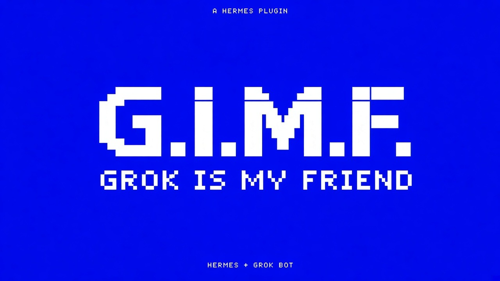

# G.I.M.F.

**Grok is my friend** (`grokbot-staff`)



**A chief-of-staff and a specialist team inside Hermes, plus an optional bridge that hands long jobs to your own Grok Bot.**

Two halves:

1. **Local staff** works with zero configuration. A `chief` breaks work down and routes it to
   specialists (`research`, `design`, `writing`, `product`, `engineering`). Each specialist answers with
   its own system prompt on whatever model you already use in Hermes (`ctx.llm`). Jobs are saved, and a Desktop
   pane shows the team and its recent work. You can replace the team from Settings without touching code.
2. **Grok Bot bridge** is optional and fails closed. Hermes hands a task *to* your own Grok Bot, a cloud
   coworker that keeps working while your laptop sleeps, through a webhook routine you create or a shared
   inbox folder. When the answer is ready, Hermes collects it.

## Harness, Loop, Graph (new in 0.2)

0.2 applies the three-layer framework from [@0xWhitemon](https://x.com/0xWhitemon)'s
["Harness, Loop, Graph: The 3 Layers That Decide If Your AI Agent Works"](https://x.com/0xWhitemon/status/2119430401701621865):
the same model with the same prompt does much better or much worse depending on what sits around it.

- **Harness: a contract and a progress file.** `staff_assign` takes an optional contract with
  `task`, `inputs`, `deliverable`, `constraints` and `done_when`, which is a list of verifiable
  criteria. If you leave `done_when` out, the chief drafts it first and records it. Every job
  gets its own folder with `contract.json`, `progress.json` (`goal`, `tried`, `learned`, `next`,
  `never`), one `attempt-N.json` per try, `review.json` and `deliverable.md`. A job survives a
  session restart, and `staff_status job_id=<id>` reads all of it back.
- **Loop: verify, retry, or stop.** A separate verifier call checks each answer against
  `done_when` and returns structured feedback: `failed`, `expected`, `observed`, `scope` and
  `dead_ends`. That feedback, plus the accumulated `never` list, goes into the next attempt.
  The loop stops on a pass, or early when the specialist repeats itself (identical or
  near-identical after normalising). After `max_attempts` tries (3 by default) the job is marked
  **`needs_human`** with its full history instead of claiming it's done. Self-report is never
  evidence: the author's notes never reach the verifier, and a verdict that says "pass" but
  lists a failed criterion counts as a fail. A reply that can't be parsed also counts as a fail.
- **Graph: Production → Verification → Review → Delivery.** The reviewer is an independent call
  that sees only the contract and the deliverable. It never sees the author's notes, the
  specialist's prompt, earlier attempts or the verifier's feedback. Only a verified *and*
  approved deliverable is delivered. A "revise" verdict goes back into the loop. State moves
  between stages through the job files, not through chat memory.

It still needs zero configuration. A plain `staff_assign(specialist, task)` call from 0.1 works
unchanged: the chief drafts the criteria and the loop runs. Set `quality_loop: false` to go back
to the single-answer behaviour, which makes fewer model calls. A job that ends up `needs_human`
can be picked up again with `staff_assign resume_job_id=<id>` (optionally with sharper
`done_when` or more `context`), or with `/staff resume <id>`.

```json
{"specialist": "writing", "task": "Landing hero copy for Pixel Habit",
 "inputs": ["audience: product designers"], "deliverable": "headline + subline",
 "constraints": ["headline under 60 characters", "no emoji"],
 "done_when": ["has exactly one headline and one subline", "headline is under 60 characters",
               "mentions habits or streaks"]}
```

Cost: a passing job takes about 4 model calls (draft criteria, produce, verify, review). Each
retry adds 2 or 3 more. The Desktop pane shows attempts, the latest verifier feedback and the
review verdict, and has a **Needs you** list.

## How it differs

| Project | Direction | What it does |
|---|---|---|
| Hermes `agent-importers` (official) | Grok Bot → Hermes, one time | Copies routines, skills and memory into Hermes |
| [grokbot-hermes-bridge](https://github.com/iamsupersocks/grokbot-hermes-bridge) | Grok Bot → Hermes, live | Lets Grok Bot call Hermes over MCP |
| **grokbot-staff** | **Hermes → Grok Bot, live** + a local team | Hermes gets a staff team and can delegate work to your Grok Bot, then collect the result |

It does not import or migrate anything. It does not call any Grok Bot API either, because Grok Bot has no public REST API.

## Install

```bash
hermes plugins install leoresendedop-sys/grokbot-staff --enable
# or, from a checkout:
ln -s "$PWD" ~/.hermes/plugins/grokbot-staff && hermes plugins enable grokbot-staff
```

On Desktop, turn on the **G.I.M.F.** pane under Capabilities → Plugins. Like every desktop half, it starts disabled.

## Tools, commands, surfaces

| Name | Kind | Purpose |
|---|---|---|
| `staff_assign` | tool | Run a task contract with one specialist (`chief` returns a plan) through produce → verify → review, then deliver or mark `needs_human`; `resume_job_id` continues a job |
| `staff_status` | tool | Show the roster and recent jobs (attempts, review verdict, `needs_human`), or one job in full: contract, progress, every attempt's feedback, review |
| `grokbot_delegate` | tool | Create a handoff and send it by webhook and/or inbox file |
| `grokbot_collect` | tool | Read `results/<id>.*` from the inbox, or take a pasted result, and mark the job done |
| `grokbot_status` | tool | List pending, done and failed handoffs, and which paths are configured |
| `/staff` | slash | `/staff` · `/staff design hero ideas for a fintech app` · `/staff status <id>` · `/staff resume <id>` |
| `/grokbot` | slash | `/grokbot <task>` · `/grokbot status` · `/grokbot collect <id> [pasted result]` |
| `staff` delegation backend | `register_delegation_provider` | `/delegation staff` adds a `specialist` parameter to `delegate_task`. A specialist with a `profile` runs as that Hermes profile |
| `grokbot-staff:grokbot-staff` | skill | Team playbook for the agent |
| Desktop pane | `desktop/plugin.js` | Team cards, loop status, a *Needs you* list, pending handoffs, recent jobs with attempts / feedback / review verdict, and a link to Settings |

## Settings (Settings → Plugins → grokbot-staff)

| Key | Type | Default |
|---|---|---|
| `specialists` | JSON list | empty, which means the built-in team |
| `grokbot_webhook_url` | **secret** (env `GROKBOT_STAFF_WEBHOOK_URL`) | unset |
| `grokbot_inbox_dir` | str | unset |
| `webhook_timeout_seconds` | int | 15 |
| `max_output_tokens` | int | 1200 |
| `quality_loop` | bool | true (verifier + reviewer on every job) |
| `max_attempts` | int | 3 (1–10) |

Custom team example:

```json
[{"id": "chief", "title": "Chief of staff", "prompt": "Plan and route."},
 {"id": "legal", "title": "Contracts reviewer", "focus": "SaaS contracts", "prompt": "Review clauses..."},
 {"id": "growth", "title": "Growth", "focus": "acquisition", "prompt": "...", "profile": "growth"}]
```

### Handoff payload

A handoff is sent as a POST to your webhook and written to `<inbox>/handoffs/<id>.json`:

```json
{"id": "gbs-1a2b3c4d5e6f", "created_at": "2026-11-07T15:00:00Z", "specialist": "research",
 "title": "Pricing teardown", "task": "...", "reply_hint": "..."}
```

Your Grok Bot routine replies by saving `<inbox>/results/<id>.md` (or `.json` with `{"result": "..."}` or `.txt`).
If it can't write files, paste its answer back with `grokbot_collect result=...`.

## Demo script (under 90 s)

1. **0–10 s.** Hermes Desktop with the G.I.M.F. pane open: "Grok is my friend."
2. **10–30 s.** `/staff chief plan a launch of a livestock-monitoring app`. The chief returns a plan that assigns items to research, design, writing, product and engineering.
3. **30–45 s.** `/staff design landing hero ideas with Three.js`. The answer streams in, and the job appears in the pane.
4. **45–65 s.** "Now the heavy research goes to my cloud coworker": `/grokbot deep market scan of cattle CV vendors in Brazil`. Job `gbs-…` shows up under *Pending Grok Bot handoffs*, and Grok Bot's webhook routine fires.
5. **65–80 s.** Grok Bot drops `results/gbs-….md` into the shared folder, then `/grokbot collect gbs-…`. The result is shown and the job is marked done.
6. **80–90 s.** Close on the comparison table: "Not an import. Not Grok Bot calling Hermes. Hermes delegating to Grok Bot."

## Security notes

- **No credentials in the repo.** The webhook URL is a `secret` setting read with `agent.secret_scope.get_secret`. Logs and tool output only ever show `scheme://host/...`.
- **Network.** HTTP requests go only to the webhook URL you set, and only when you call `grokbot_delegate`. The URL must be https (plain http is allowed for localhost only). Redirects are never followed, URLs with user info are rejected, and the timeout is capped at 120 s.
- **Files.** The plugin writes jobs to `<HERMES_HOME>/plugin-data/grokbot-staff/jobs.json` and
  per-job files to `<HERMES_HOME>/plugin-data/grokbot-staff/jobs/<id>/`. If you set an inbox folder, it writes `handoffs/` and reads `results/` there. Job ids are validated, so there is no path traversal. Symlinked result files and files over 2 MB are ignored.
- **LLM calls.** These use `ctx.llm` with your current provider and host-owned credentials. They are only made when a staff tool or command runs. With the loop on, one job makes a bounded number of calls: 1 + up to 3 per attempt.
- **Nothing else.** No shell commands, no background processes, no telemetry, no self-updater, no `eval`. The Desktop half imports only `@hermes/plugin-sdk` and `react` and reads its own `/api/plugins/grokbot-staff/overview` route, which is read-only.
- Do not put passwords or tokens in a handoff task. It is sent to your webhook and written to disk as plain text.

## Development

```bash
python3 -m unittest discover -s tests -t . -v      # stdlib only, no network
hermes plugins validate . --install-deps
hermes plugins doctor . --ci
```

## License

MIT
